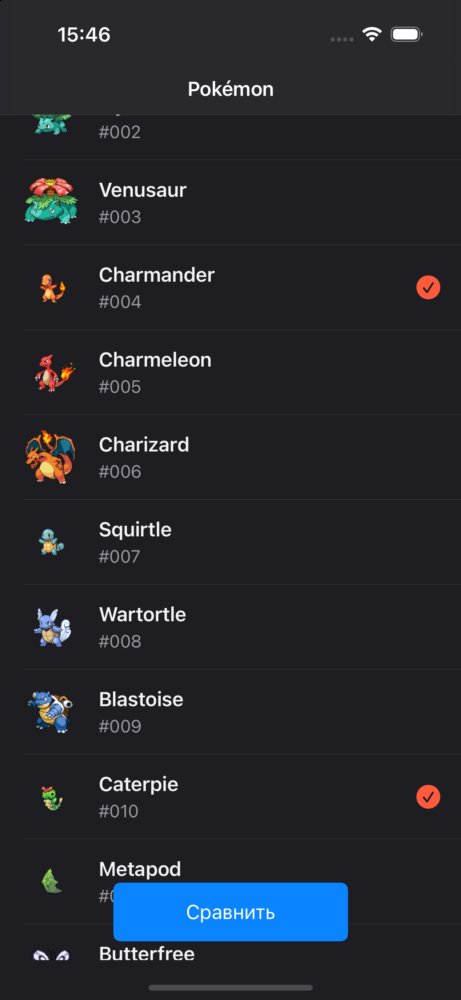
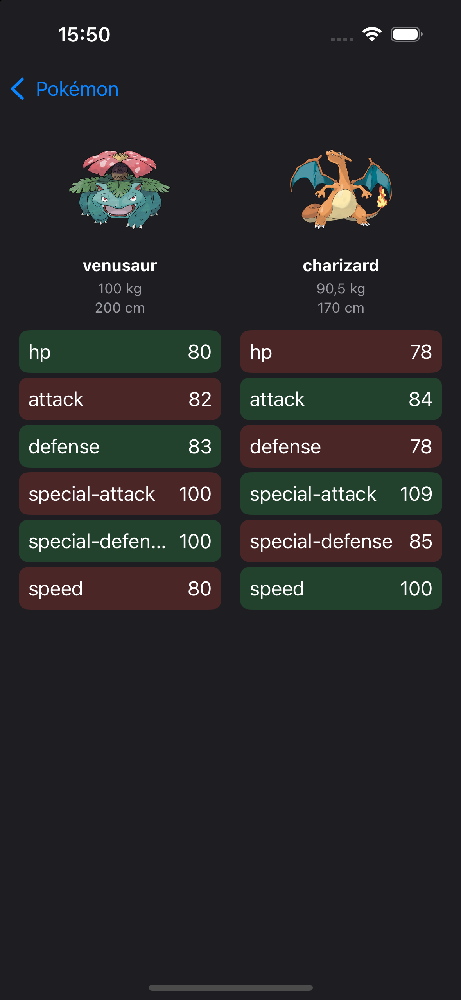

# PokéCompare

An iOS app for comparing two Pokémon side by side. Browse the Pokédex, pick any two Pokémon, and see whose stats come out on top.

Built with **UIKit (100% programmatic UI)**, **MVVM**, and a **protocol-oriented networking layer** on top of [PokéAPI](https://pokeapi.co).
| Pokémon list | Comparison |
|:---:|:---:|
|  |  |

## Features

- **Paginated Pokémon list** loaded from PokéAPI as you scroll
- **Pick two Pokémon** and open the comparison screen with one tap
- **Side-by-side comparison**: official artwork, name, weight, height, and base stats
- **Per-stat result highlighting**: each stat is marked as higher, lower, or equal compared to the opponent
- **Parallel loading**: both Pokémon are fetched at the same time with `async let`
- **Loading state**: spinner while data is loading
- **User-friendly error handling**: clear messages for no internet, timeouts, server errors, and not-found; cancelled requests are ignored silently; the list screen offers a **Retry** action
- **Localized units**: weight and height are formatted with `MeasurementFormatter` (kg / cm)

## Tech stack

| Area | Approach |
|---|---|
| UI | UIKit, programmatic Auto Layout (no Storyboards) |
| Architecture | MVVM with closure-based bindings |
| Concurrency | Swift Concurrency: `async/await`, `async let`, `@MainActor` view models |
| Networking | `URLSession` + generic `NetworkClient` and `Endpoint` protocol |
| Parsing | `Codable` |
| Images | [Kingfisher](https://github.com/onevcat/Kingfisher) |
| API | [PokéAPI](https://pokeapi.co) |

## Architecture

```
View (UIView)  ←  ViewController  ←→  ViewModel  →  NetworkClientProtocol  →  PokéAPI
   layout only      binds callbacks     state, logic,      generic request<T>
                                        display models
```

- **Views** (`ComparisonView`, `PokemonColumnView`, `StatRowView`) only handle layout and expose a `configure(with:)` method. Reusable pieces are composed: one `PokemonColumnView` is used twice on the comparison screen, and each column builds its stat rows from `StatRowView`.
- **ViewControllers** create the view, bind to the view model's callbacks (`onLoading`, `onResult`, `onError`), and start loading. They contain no business logic.
- **ViewModels** (`PokemonListViewModel`, `ComparisonViewModel`) are `@MainActor`, depend on `NetworkClientProtocol` (injected via `init`), and turn raw API models into display models (`PokemonColumnDisplay`, `StatRow`). Stat comparison happens here, so the UI receives ready-to-show data.
- **Networking**: endpoints are described by a protocol (path, method, query items), and a single generic `NetworkClient.request<T: Decodable>(_:)` executes any of them. Errors are mapped to a `NetworkError` enum (transport, status code, decoding) that provides a user-facing message and knows whether the request was cancelled.

## Getting started

1. Clone the repository
   ```bash
   git clone <repo-url>
   ```
2. Open the project in Xcode. Dependencies (Kingfisher) are resolved via Swift Package Manager.
3. Build and run on a simulator or device.

No API key is required: PokéAPI is free and open.

**Requirements:** iOS 18.6+, Xcode  27

## What I'd improve next

- Unit tests for view models and the networking layer (with a mock `NetworkClientProtocol`)
- Retry with backoff for retryable errors
- Image placeholder and fade-in for artwork
- Search by Pokémon name

## Credits

Data and artwork: [PokéAPI](https://pokeapi.co). Pokémon and Pokémon character names are trademarks of Nintendo.
